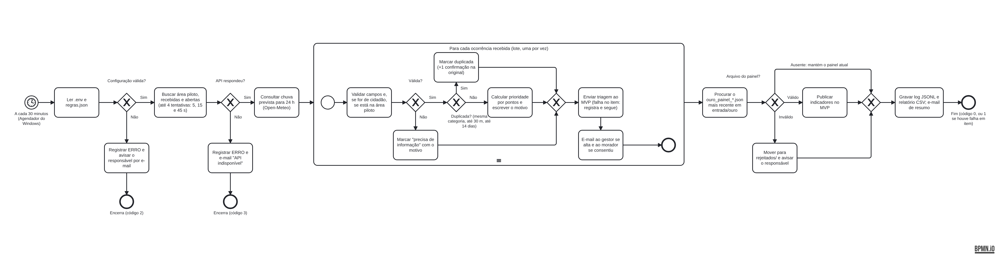

# ZelaCidade · Robô de triagem (RPA) · Global Solution FIAP 2026.2

> Bruno Venturi Lopes Vieira · RM 99431
> Guilherme Alves de Lima · RM 550433
> Leonardo de Oliveira Ruiz · RM 98901

## Ficha técnica

| Item | Descrição |
|---|---|
| Produto | ZelaCidade: o morador registra problemas de manutenção em espaços públicos com foto e local; a IA sugere a categoria, um robô faz a triagem, a comunidade confirma e a organização responsável acompanha num painel |
| Cidadão e território | Moradores da Zona Norte de São Paulo, na área da Subprefeitura Santana/Tucuruvi: Santana, Jardim São Paulo, Mandaqui e Tucuruvi |
| Problema | Buracos, calçadas quebradas, iluminação apagada e obstáculos ficam sem registro organizado e sem prioridade clara |
| Este robô | Python com o template BotCity (Custom); roda no Windows a cada 30 minutos |
| MVP | <https://app-zelacidade-gs-99431.azurewebsites.net> · repo <https://github.com/brunoventuri01/zelacidade> |
| ODS | 11 (metas 11.3 e 11.7) e 9 (meta 9.1) |

## Objetivo e benefício para o cidadão

Sem o robô, alguém da organização responsável teria de abrir cada registro novo, conferir se está no bairro atendido, procurar se o problema já foi registrado e decidir o que é urgente. O robô faz isso a cada 30 minutos, com regras fixas e explicáveis:

- o morador recebe uma resposta rápida: triado, somado como confirmação de um registro existente ou com um pedido de mais informação;
- a organização vê primeiro o que é urgente, com o motivo escrito na linha do tempo da ocorrência;
- registros repetidos viram confirmações, em vez de duplicar o trabalho.

## O processo



O fluxo está em [`docs/processo.bpmn`](docs/processo.bpmn), que abre e pode ser editado no <https://demo.bpmn.io>.

1. **Início.** O Agendador de Tarefas do Windows dispara o robô, que lê o `.env` e o `src/regras.json`. Se a configuração estiver ausente ou inválida, o robô grava um log de ERRO, avisa o responsável por e-mail e encerra com código 2.
2. **Buscar.** O robô busca a área piloto, as ocorrências `recebida` e as abertas dos últimos 14 dias. Se a API estiver fora, ele faz até 4 tentativas, esperando 5, 15 e 45 s entre elas. Se todas falharem, grava o log, manda o e-mail "API indisponível" e encerra com código 3. Nada falha em silêncio.
3. **Para cada ocorrência (lote):**
   - **Validar.** A categoria precisa ser conhecida e a ocorrência precisa ter localização. Registro de cidadão fora da área piloto vira `precisa_info`, com o motivo. Os testes de bancada do robô Maker ficam fora dessa regra e são marcados como teste.
   - **Duplicada?** Mesma categoria, ainda aberta, a até 30 m e registrada há até 14 dias. Nesse caso vira `duplicada`, com `duplicada_de` preenchido, e o MVP soma +1 confirmação na original. Registro simulado nunca casa com registro real.
   - **Prioridade por pontos:**
     - categoria: buraco e obstáculo valem 3 pontos, iluminação 2, as outras 1;
     - +1 a cada 2 confirmações;
     - +1 se a IA sugeriu a mesma categoria com 70% de confiança ou mais;
     - +2 para buraco se o Open-Meteo previr 10 mm ou mais de chuva em 24 h.

     São alta 5 pontos ou mais, média 3 ou 4 e baixa até 2. O motivo vai em texto, por exemplo: `buraco na via (+3) + IA confirmou com 89% (+1) + chuva prevista de 15 mm em 24 h (+2) = 6 pontos, prioridade alta.`
   - **Devolver ao MVP** (`PATCH /api/v1/integracao/ocorrencias/{id}/triagem`). Se um item falhar, o robô registra e segue com os próximos.
   - **Avisar.** Prioridade alta gera e-mail ao gestor. O morador recebe um aviso só se deu e-mail e consentimento.
4. **Publicar indicadores.** O robô procura o `ouro_painel_*.json` mais recente em `entrada/ouro/`, exportado da camada Ouro do Databricks. Se não houver arquivo, só registra um aviso e o painel atual continua. Se o arquivo for inválido (esquema, totais negativos, data no futuro ou com mais de 3 dias), ele vai para `entrada/rejeitados/` e o responsável é avisado. Se for válido, é publicado com `POST /api/v1/integracao/painel` e arquivado em `entrada/ouro/publicados/`.
5. **Fechar.** O robô grava o relatório do dia em CSV (`saida/relatorios/`), o log de auditoria em JSONL (`logs/`) e manda um e-mail de resumo. O código de saída é 0, ou 1 se algum item falhou.

As regras ficam em [`src/regras.json`](src/regras.json): mudar um limite muda a decisão sem mexer no código.

## Tecnologias e justificativa

| Tecnologia | Por quê |
|---|---|
| Python 3.10 ou mais novo | Mesma linguagem do MVP e das aulas; regras fáceis de testar |
| Template BotCity (Custom) e `botcity-maestro-sdk` | Estrutura de projeto vista em aula; o robô pode ser publicado no BotCity Maestro sem mudar o código (fora do Maestro ele roda normalmente) |
| `requests` | Chamadas à API do MVP e ao Open-Meteo |
| `python-dotenv` | Segredos no `.env`, fora do Git |
| `smtplib` (Gmail com senha de app) | E-mails de alerta, de prioridade e de resumo |
| Agendador de Tarefas do Windows | Execução a cada 30 minutos sem depender de um servidor |

O robô conversa com o MVP pela API, sem clicar na tela. Isso é mais estável e mais rápido que automação de interface, e o MVP foi feito pelo próprio grupo com uma rota própria para o robô.

## Estrutura

| Caminho | Conteúdo |
|---|---|
| `src/bot.py` | Ponto de entrada do BotCity: carrega a configuração, roda o processo e informa o resultado ao Maestro |
| `src/triagem/` | `regras.py` (decisões), `execucao.py` (o processo), `api.py` (tentativas), `painel.py`, `clima.py`, `notificacao.py` e `registro.py` (log e relatório) |
| `src/regras.json` | Limites e pesos das regras |
| `tests/` | `pytest` das regras e dos 3 cenários: sucesso, decisão e falha |
| `docs/` | Fluxo em BPMN (`.bpmn` e `.png`) |
| `logs/amostra/` | Amostras de log e de relatório: um teste local e os logs de produção de 16 e 17/11 |
| `assets/` | Prints usados no PDF e no vídeo |
| `entrada/ouro/`, `entrada/rejeitados/` | Onde entra o JSON da Ouro e para onde vão os inválidos |

## Como rodar (Windows)

1. Instale as dependências num ambiente virtual:

   ```powershell
   cd zelacidade-rpa
   python -m venv venv
   .\venv\Scripts\Activate.ps1
   pip install --upgrade -r requirements-dev.txt
   ```

2. Crie o `.env` a partir do exemplo e preencha a `RPA_API_KEY` e o e-mail:

   ```powershell
   Copy-Item .env.example .env
   notepad .env
   ```

   Para o Gmail, ligue a verificação em 2 etapas e gere uma senha de app; ela vai em `SMTP_SENHA`.

3. Rode uma vez:

   ```powershell
   cd src
   python bot.py
   ```

4. Agende a cada 30 minutos (troque o caminho pelo da sua pasta):

   ```powershell
   schtasks /Create /SC MINUTE /MO 30 /TN "ZelaCidade Triagem" /TR "\"C:\caminho\zelacidade-rpa\venv\Scripts\python.exe\" \"C:\caminho\zelacidade-rpa\src\bot.py\""
   ```

   Para remover o agendamento: `schtasks /Delete /TN "ZelaCidade Triagem" /F`.

### Testes

```powershell
python -m pytest tests
```

| Cenário | Teste | O que mostra |
|---|---|---|
| Sucesso | `test_cenario_sucesso_triagem_relatorio_log_e_painel` | Lote triado, CSV e JSONL gravados, painel publicado |
| Decisão | `test_cenario_decisao_duplicada_e_alta_por_chuva` | Uma duplicada que soma confirmação e um buraco que vira alta pela chuva |
| Falha | `test_cenario_falha_api_fora_do_ar` | API fora: tentativas, log de erro, e-mail de alerta e código 3 |

Também há testes para item com erro, item inconsistente, painel inválido, ausente ou velho, configuração inválida e as esperas de 5, 15 e 45 s.

### Reproduzir os cenários no vídeo

- **Alta por chuva:** se não estiver chovendo, defina `ZELA_CHUVA_SIMULADA_MM=15` no `.env`. O log registra que a chuva é simulada.
- **API desligada:** rode com uma URL que não responde, sem mexer no `.env`:

  ```powershell
  $env:ZELA_API_URL="http://127.0.0.1:9"; python bot.py; Remove-Item Env:ZELA_API_URL
  ```

## Vídeo e evidências

- **Vídeo demonstrativo (até 3 min):** https://www.youtube.com/watch?v=AuMV6zlAMrI
- **Prints** da execução em produção, das exceções e da integração com o MVP: [`assets/`](assets/)
- **Logs de produção** de 16 e 17/11/2026 (só id e protocolo, sem dados pessoais): [`logs/amostra/`](logs/amostra/)

| Evidência | Arquivo |
|---|---|
| Triagem real de 16/11: 5 fora da área, 1 média, 1 duplicada | [assets/02_execucao_real_16-11.png](assets/02_execucao_real_16-11.png) |
| Motivo da triagem na linha do tempo do MVP | [assets/03_linha_do_tempo_ZC-000207.png](assets/03_linha_do_tempo_ZC-000207.png) |
| Duplicada somada como confirmação | [assets/04_duplicada_ZC-000208.png](assets/04_duplicada_ZC-000208.png) |
| API fora: 4 tentativas e código 3 | [assets/10_falha_api_tentativas.png](assets/10_falha_api_tentativas.png) |
| Painel inválido rejeitado | [assets/12_painel_invalido_rejeitado.png](assets/12_painel_invalido_rejeitado.png) |
| Painel publicado na tela do MVP | [assets/19_tela_painel_mvp.png](assets/19_tela_painel_mvp.png) |

Limitação conhecida: a ZC-000207 e a ZC-000208 são buracos diferentes a 8 m um do outro. A regra de duplicidade usa só categoria, distância e tempo, então somou a 208 como confirmação; um raio menor para buraco ou a comparação das fotos resolveria.

## Segurança e LGPD

- A `RPA_API_KEY` e a senha do e-mail ficam no `.env`, fora do Git.
- O log e o relatório guardam só o id e o protocolo da ocorrência, nunca e-mail ou nome.
- O e-mail ao morador só sai se ele deu e-mail e consentimento. A API do MVP nem devolve o e-mail de quem não consentiu.
- Registros simulados nunca recebem e-mail: os endereços deles são fictícios (`@exemplo.com`).
- O e-mail do robô é uma conta de teste do grupo.
